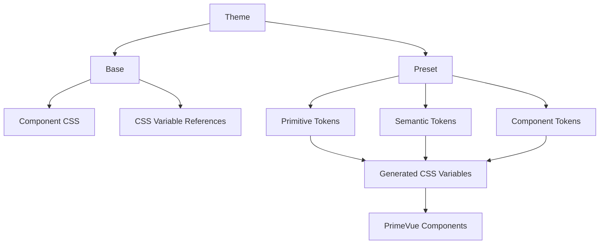
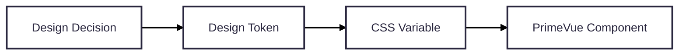
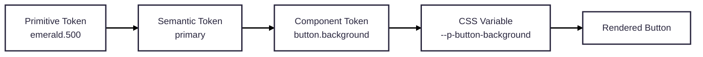
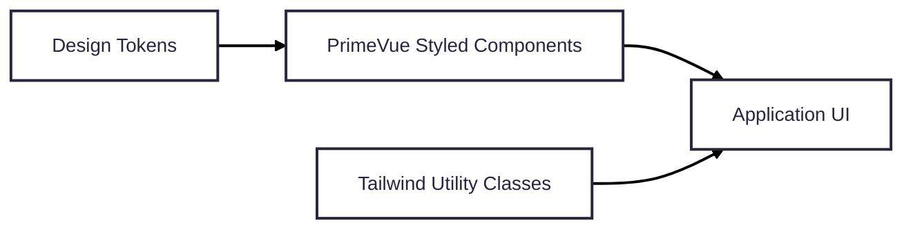
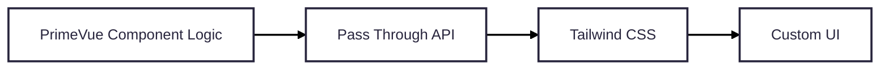
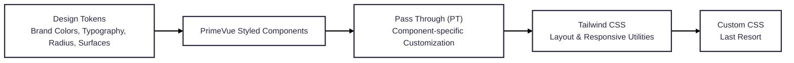

# PrimeVue V5 Overview
PrimeVue is a **comprehensive UI component library** for Vue.js that provides a wide range of production ready components. PrimeVue v5 continues the architecture introduced in v4 and further matures its **design token system**, official **Tailwind integration**, developer tooling, and documentation. This replaces its traditional approach of customizing components through CSS overrides.

The current ecosystem emphasizes:
- Centralized theme management
- Better scalability
- Improved maintainability
- Stronger Tailwind CSS integration
- Flexible styling approaches (Styled and Unstyled modes)
---
## Previous Versions VS Version 5
| Previous Versions                      | PrimeVue v5                         |
| -------------------------------------- | ----------------------------------- |
| SASS-based themes                      | Design Token based themes           |
| theme.css compiled beforehand          | Runtime CSS Variables               |
| Manual CSS overrides                   | Token customization                 |
| Limited Tailwind integration           | Official Tailwind integration       |
| Theme switching required replacing CSS | Dynamic preset switching            |
| Styling mostly global                  | Component level token customization |
**Key Improvements**
- New Design Token based theming system
- Theme Presets (Aura, Material, Lara, Nora)
- Better dark mode configuration
- Official Tailwind CSS plugin
- Improved scalability for enterprise applications
- Cleaner customization workflow
---
## Theming Architecture
```text
Theme
│
├── Base
│     ├── Component CSS
│     └── CSS Variable References
│
└── Preset
      ├── Primitive Tokens
      ├── Semantic Tokens
      └── Component Tokens
```

### Base
```css
background: var(--p-primary-color);
```
- Contains the CSS rules
- Uses CSS variables

### Preset
The Preset contains all Design Tokens that define the application's visual appearance. The current PrimeVue v5 documentation provides 4 official presets, each with different appearance style without modifying component CSS.

| Preset       | Description                                                   |
| ------------ | ------------------------------------------------------------- |
| **Aura**     | Modern and minimal design. Recommended for most applications. |
| **Lara**     | Clean business style with balanced spacing and colors.        |
| **Material** | Inspired by Google's Material Design.                         |
| **Nora**     | Rounded, soft UI with a friendly appearance.                  |



>Developers may also create their own preset without modifying component source code. ([primevue.dev](https://primevue.dev/theming/styled "Styled Mode - PrimeVue"))
---
## Styled Mode vs Unstyled Mode

### Styled Mode
Styled Mode is the default configuration. It provides fully styled components immediately after installation.
PrimeVue supplies:
- Component behavior
- Styling
- Design tokens
- Built in themes
Developers mainly customize tokens.

Suitable when:
- Rapid development is required
- Consistent UI is desired
- Limited CSS customization is needed

### Unstyled Mode
Unstyled Mode removes all default component styling.
PrimeVue only provides:
- Accessibility
- State management
- Component logic

Developers supply every style using:
- Tailwind
- Bootstrap
- UnoCSS
- Custom CSS

It is ideal for situations:
- Team needs maximum flexibility
- Customize design systems
- Tailwind compatability
---
## Migration Considerations
When upgrading existing projects, several considerations should be evaluated.
### Recommended Changes
- ✔ Replace CSS overrides with Design Tokens
- ✔ Create custom presets instead of editing theme files
- ✔ Configure dark mode through theme configuration
- ✔ Use the official Tailwind plugin
### Potential Challenges
- Learning the Design Token hierarchy
- Migrating existing CSS customizations
- Understanding token inheritance
- Refactoring legacy themes

---
# Design Tokens
Design Tokens are the foundation of PrimeVue's styling system. It is the reusable variables that store visual properties such as:
- Colors
- Typography
- Border radius
- Spacing
- Shadows



Instead of defining values repeatedly:
```css
background: #3B82F6;
```

Applications reference a token:
```css
background: var(--p-primary-color);
```
Changing one token automatically updates every component using that token.
This provide benefits such as:
- Centralized styling
- Consistent UI
- Easier branding
- Better scalability
- Dynamic theme switching
- Less duplicated CSS

Design Tokens are separated into three levels, [Primitive](3.%20Developer%20Guide.md#1-primitive-tokens), [Semantic](3.%20Developer%20Guide.md#2-semantic-tokens), and [Component](3.%20Developer%20Guide.md#3-component-tokens). The detailed explanation of each token is documented in [Developer Guide](3.%20Developer%20Guide.md#4.%20Token%20Customization).


---
### Token Inheritance
PrimeVue follows a hierarchical inheritance model:


Changing one Primitive Token may affect every component that references it, which minimizes code duplication across development.

---
### Overriding Existing Tokens
PrimeVue recommends using `definePreset()`.
```javascript
import Aura from '@primeuix/themes/aura';
import { definePreset } from '@primeuix/themes';

const MyPreset = definePreset(Aura, {
    semantic: {
        primary: {
            500: '{emerald.500}'
        }
    }
});
```
> Instead of editing CSS, developers override tokens within the preset, producing a reusable and maintainable theme. ([primevue.dev](https://primevue.dev/theming/styled "Styled Mode - PrimeVue"))

Benefits
- Non-destructive
- Easier upgrades
- Reusable configuration
---
### Recommended Practices
- Customize through design tokens instead of overriding CSS.
- Modify Semantic Tokens before Component Tokens
- Use component tokens only for component specific exceptions.
- Keep primitive tokens reusable and generic.
- Build reusable theme presets instead of scattering CSS across the project.
- Keep branding centralized
- Avoid editing PrimeVue source files
- Reserve Tailwind utilities for layout and spacing, while using design tokens for branding and component appearance. ([primevue.dev](https://primevue.dev/theming/styled "Styled Mode - PrimeVue"))
---
# Tailwind Integration
## Official Plugin
PrimeVue provides the official **tailwindcss-primeui** plugin.

Installation:
```bash
npm install tailwindcss-primeui
```

The plugin exposes PrimeVue theme values directly as Tailwind utilities, allowing classes such as:

```text
bg-primary
text-surface-500
text-muted-color
rounded-border
```
These utilities automatically stay synchronized with the active PrimeVue design tokens. ([primevue.org](https://primevue.org/tailwind "Tailwind CSS - PrimeVue"))

---
## Styled Mode + Tailwind


```vue
<Button
    class="w-full mt-4"
/>
```
Tailwind handles:
- spacing
- layout
- flex
- grid
- responsive utilities

PrimeVue handles:
- colors
- typography
- states
- component styling
This is the recommended approach for most projects.

---
## Unstyled Mode + Tailwind
Unstyled Mode removes all built-in styling, allowing developers to implement a completely custom design system.

Every component is styled manually. Allowing users to have:
- Complete visual control
- Custom design system
- Suitable for enterprise branding

PrimeTek also provides **Volt UI**, an open source component library built using Unstyled PrimeVue and Tailwind, demonstrating this approach. 

---
## CSS Layer Configuration
PrimeVue supports CSS Layers to avoid style conflicts.

Recommended layer order
```text
theme
↓
base
↓
primevue
↓
utilities
```
Benefits
- Better specificity control
- Easier overrides
- Cleaner integration
Developers can configure layer ordering to reduce specificity conflicts when combining PrimeVue with Tailwind, helping ensure predictable style precedence.
---
## Dark Mode Configuration
PrimeVue supports configurable dark mode through:

```text
darkModeSelector
```
The actual implementation can look into [[Task3_PrimeVue/3. Developer Guide#4. Dark Mode|Dark Mode Configuration]].

---
## Best Practices
- ✔ Use Design Tokens for branding
- ✔ Use Tailwind for layout
- ✔ Create reusable theme presets
- ✔ Configure CSS Layers correctly
- ✔ Keep dark mode consistent

---
## Common Pitfalls
- ⚠ Overriding generated CSS directly
- ⚠ Editing built-in theme files
- ⚠ Ignoring token inheritance
- ⚠ Mixing multiple customization approaches inconsistently
- ⚠ Incorrect CSS layer ordering

---
## Comparison of Customization Approaches
| Approach                 | Advantages                                        | Limitations                                  | Best Use Case                     |
| ------------------------ | ------------------------------------------------- | -------------------------------------------- | --------------------------------- |
| Tailwind Utilities Only  | Maximum flexibility                               | Repeated styling, limited global consistency | Fully custom UI                   |
| Design Tokens Only       | Centralized theme management, consistent branding | Less granular layout control                 | Standard PrimeVue applications    |
| Design Tokens + Tailwind | Consistent theming with flexible layouts          | Requires understanding both systems          | Recommended for most Vue projects |
### Decision Matrix
| Requirement                        | Recommended Approach |
| ---------------------------------- | -------------------- |
| Company branding                   | Design Tokens        |
| Global colors                      | Design Tokens        |
| Layout and spacing                 | Tailwind CSS         |
| Responsive design                  | Tailwind CSS         |
| Component-specific styling         | Pass Through         |
| Application-wide component styling | Component Tokens     |
| Custom behavior                    | PrimeVue Props       |
| Unsupported styling                | Custom CSS           |

## Recommended Approach
