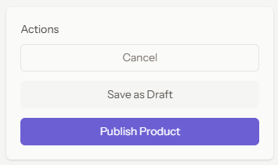
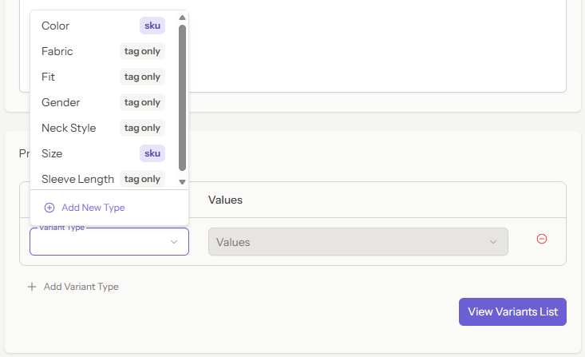
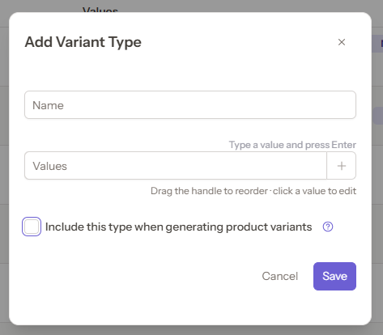
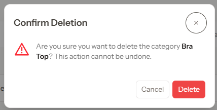
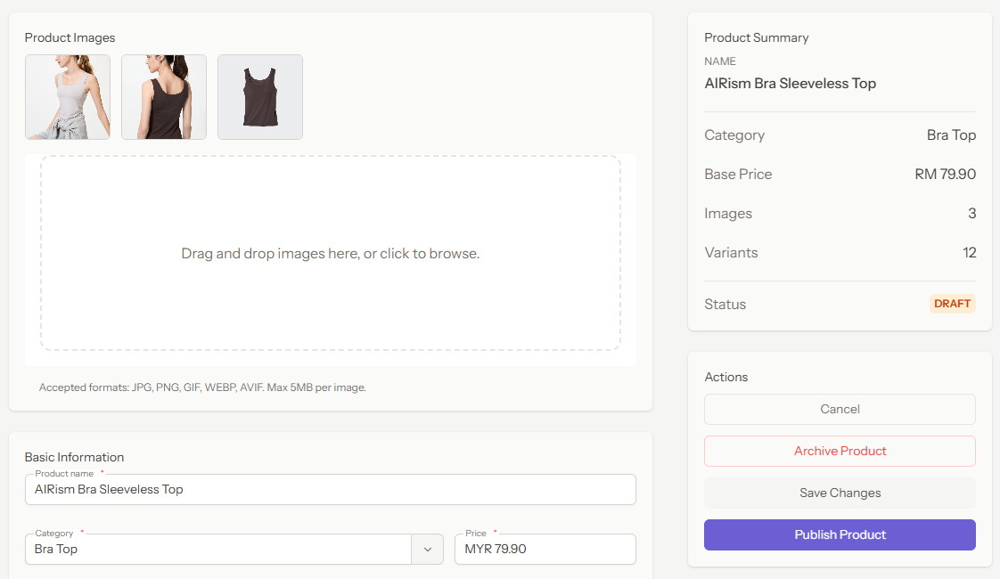
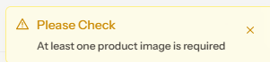
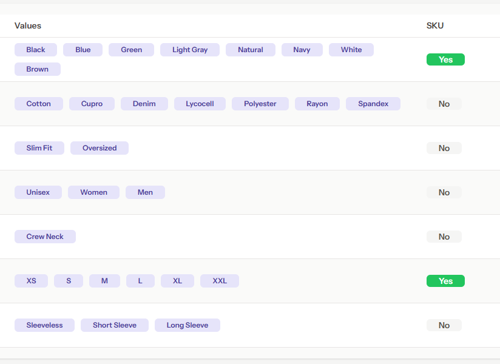

# Theme Customization
## 1. Altering primary color
Create Preset Colors:
```typescript
import { definePreset } from '@primeuix/themes';
import Aura from '@primeuix/themes/aura';

const Noir = definePreset(Aura, {
  semantic: {
    primary: {
      50: '{indigo.50}',
      100: '{indigo.100}',
      200: '{indigo.200}',
      300: '{indigo.300}',
      400: '{indigo.400}',
      500: '{indigo.500}',
      600: '{indigo.600}',
      700: '{indigo.700}',
      800: '{indigo.800}',
      900: '{indigo.900}',
      950: '{indigo.950}',
    },
    ...
```

Import Tailwind Colors for Theme Switching 
```typescript
import colors from 'tailwindcss/colors';

export interface ColorOption {
    name: string;
    palette: Record<string, string> | Record<string, never>;
}

export const presetColors: ColorOption[] = [
    { name: 'noir', palette: {} },
    { name: 'emerald', palette: colors.emerald },
    { name: 'green', palette: colors.green },
    { name: 'lime', palette: colors.lime },
    { name: 'orange', palette: colors.orange },
    { name: 'amber', palette: colors.amber },
    { name: 'yellow', palette: colors.yellow },
    { name: 'teal', palette: colors.teal },
    { name: 'teal', palette: colors.teal },
    { name: 'cyan', palette: colors.cyan },
    { name: 'sky', palette: colors.sky },
    { name: 'blue', palette: colors.blue },
    { name: 'indigo', palette: colors.indigo },
    { name: 'violet', palette: colors.violet },
    { name: 'purple', palette: colors.purple },
    { name: 'fuchsia', palette: colors.fuchsia },
    { name: 'pink', palette: colors.pink },
    { name: 'rose', palette: colors.rose },
];
```

Before:


After:


## 2. Change border radius
```typescript
components: {
  button: {
    root: {
      borderRadius: 'var(--app-border-radius, {border.radius.md})',
    },
  },
  ...
```

| Before    |  |
| --------- | ----------------------------- |
| **After** |   |

## 3. Change surface colors
```typescript
import colors from 'tailwindcss/colors';

export interface SurfaceOption {
  name: string;
  palette: Record<string, string>;
}  

export const surfaceColors: SurfaceOption[] = [
  { name: 'slate', palette: colors.slate },
  { name: 'zinc', palette: colors.zinc },
  { name: 'stone', palette: colors.stone },
  { name: 'gray', palette: colors.gray },
  { name: 'neutral', palette: colors.neutral },
];
```
Affected components:
- Card
- Dialog
- DataTable
- Input fields

| Before    |  |
| --------- | ----------------------------- |
| **After** |   |

## 4. Customize typography
```typescript
const Noir = definePreset(Aura, {
  typography: {
	lineHeight: '1.5',
	fontFamily: 'inherit',
    fontWeight: 'normal',
    fontSize: '0.875rem',
  },
  formField: {
    fontWeight: '{typography.font.weight}',
    fontSize: '{typography.font.size}',
  },
```

| Before                  |        |
| ----------------------- | -------------------------------- |
| **After** - Font Size   |    |
| **After** - Font Weight |  |

## 5. Dark mode
Prime Vue configure dark mode class
```typescript
.use(PrimeVue, {
  theme: {
    // preset: Aura,
    preset: Noir,
    options: {
      darkModeSelector: '.dark', // <-- CSS Class .dark {}
	}
  },
  // unstyled: true,
  ripple: true,
  license: primeUIKey,
})
```

Script to toggle light dark mode
```typescript
const appearance = '{{ $appearance ?? "system" }}';

if (appearance === 'system') {
  const prefersDark = window.matchMedia('(prefers-color-scheme: dark)').matches;
  if (prefersDark) {
	document.documentElement.classList.add('dark');
  }
}
```

| Light    |  |
| -------- | ------------------- |
| **Dark** |   |

## 6. Brand colors
```typescript
const brand: Record<string, string> = {
  50: '#f2f1fd',
  100: '#e6e4fa',
  200: '#cfccf5',
  300: '#aea8ec',
  400: '#8a80e0',
  500: '#6c5fd3',
  600: '#5847bd',
  700: '#48389a',
  800: '#3c2f7c',
  900: '#332964',
  950: '#1f1840',
};
```

Brand color is updated to `#6c5fd3` 


# Component Demonstration
| Components  | Image                                |
| ----------- | ------------------------------------ |
| Button      |                       |
| InputText   |                   |
| Select      |                       |
| Checkbox    |                     |
| RadioButton |                 |
| Dialog      |                       |
| Card        |                         |
| DataTable   |                   |
| Toast       |                        |
| Badge       |  |

Overall Component Designs


Theme Changing customized using design tokens


# Tailwind Integration
## Tailwind Utility Classes
```vue
<div class="space-y-6 pb-10">
  <!-- Main Grid -->
  <div class="grid grid-cols-12 gap-10">
    <div class="col-span-12 lg:col-span-8 space-y-6">
      <Card>...</Card>
    </div>
    <!-- RIGHT SIDEBAR -->
    <div class="col-span-12 lg:col-span-4">
      <div class="sticky! top-6 space-y-6">
        <Card>...</Card>
      </div>
    </div>
  </div>
</div>
```

## PrimeVue Styling
```vue
<Card>
  <template #title>Product Images</template>
    <template #content>
    <ProductImagesTab
      ref="imageTabRef"
	  v-model="form.images"
	  v-model:deleted-ids="form.deleted_image_ids"
	  :product="product"
	  :errors="form.errors.images"
	/>
  </template>
</Card>
```

## Design Token Customization
```typescript
card: {
  root: {
    borderRadius: 'var(--app-border-radius, {border.radius.md})',
    background: 'var(--card)'
  },
  title: {
    fontSize: 'var(--app-font-size, {form.field.font.size})',
    fontWeight: 'var(--app-font-weight, {form.field.font.weight})',
  },
  subtitle: {
    fontSize: 'var(--app-font-size, {form.field.font.size})',
    fontWeight: 'var(--app-font-weight, {form.field.font.weight})',
  },
},
```

| Tailwind Controls                                           | PrimeVue Controls                                              | Design Token Controls                                 |
| ----------------------------------------------------------- | -------------------------------------------------------------- | ----------------------------------------------------- |
| width<br>margin<br>padding<br>layout<br>responsive behavior | button colors<br>states<br>accessibility<br>component behavior | branding<br>colors<br>typography<br>theme consistency |

Tailwind defines page layout


Allowing Responsive Design
