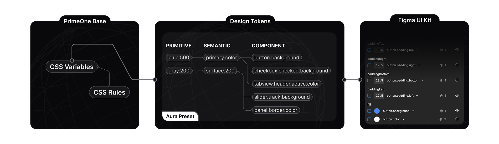
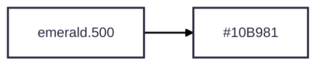
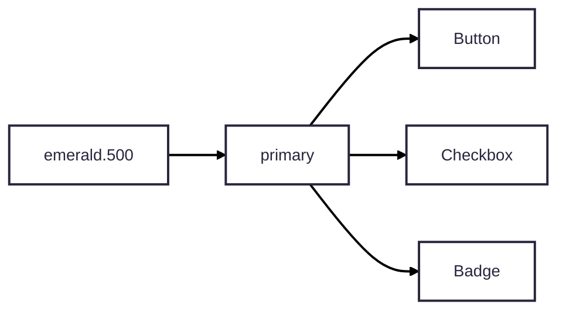
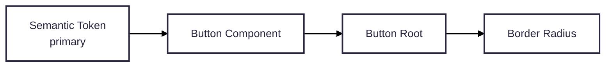
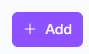
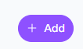
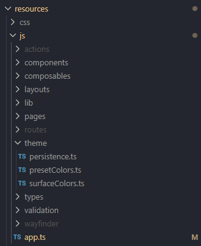
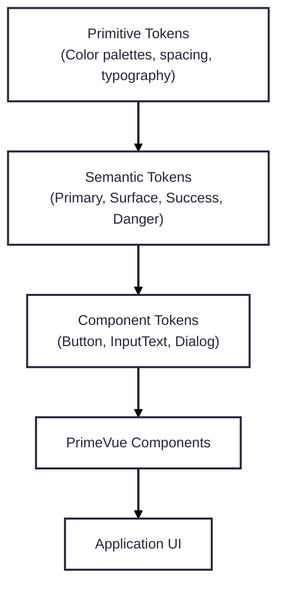
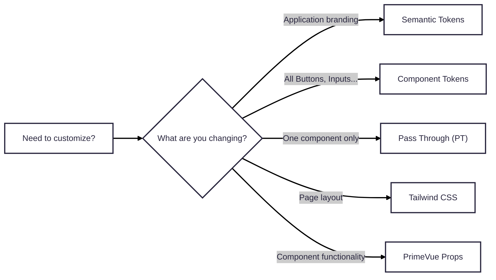

# Useful Links (Documentations)
1. [PrimeVue V5 ](https://primevue.dev/)
2. [PrimeVue - V4](https://v4.primevue.org/)
3. [Lucide Icon Library](https://v0.lucide.dev/icons/)
4. [Prime Icons](https://primevue.dev/icons/)

# 1. Installation
### Vite
#### 1. Download PrimeVue 
```
# Using npm
npm install primevue @primeuix/themes

# Using yarn
yarn add primevue @primeuix/themes

# Using pnpm
pnpm add primevue @primeuix/themes
```
>Always check PrimeVue official document for any updates

#### 2. Plugin Configuration
In `resources\js\app.ts`
```typescript
import PrimeVue from 'primevue/config';

# Choose ONE preset
import Aura from '@primeuix/themes/aura';
import Lara from '@primeuix/themes/lara'
import Material from '@primeuix/themes/material'
import Nora from '@primeuix/themes/nora'

const app = createApp(App);

app.use(PrimeVue, { 
	// Global PrimeVue Configuration
});
```

#### 3. Configuration Properties
```typescript
//Free Community License or Commercial License
license: 'PRIMEUI-LICENSE-KEY'
```

| Property  | Type     | Default | Description                                   |
| --------- | -------- | ------- | --------------------------------------------- |
| `license` | `string` | -       | PrimeVue Community or Commercial license key. |

---
```typescript
//Theme
theme: { 
	preset: Aura, 
	options: { 
		prefix: 'p',
		darkModeSelector: 'system', 
		cssLayer: false, 
		cssVariables: true 
	} 
}
```

| Property           | Type                | Default    | Description                                                                                                                       |
| ------------------ | ------------------- | ---------- | --------------------------------------------------------------------------------------------------------------------------------- |
| `preset`           | `string`            | -          | Design token presets: `Aura`, `Lara`, `Material`, `Nora`                                                                          |
| `prefix`           | `string`            | `"p"`      | Prefix used for generated CSS variables. Example: `--p-primary-color`.                                                            |
| `darkModeSelector` | `string`            | `"system"` | Controls dark mode. `"system"` follows the operating system. Custom selectors such as `".dark"` allow manual dark mode switching. |
| `cssLayer`         | `boolean \| object` | `false`    | Enables CSS Cascade Layers. Can also specify the layer name and ordering.                                                         |
| `cssVariables`     | `boolean`           | `true`     | Generates CSS variables from design tokens. Normally left enabled.                                                                |

---
```typescript
unstyled: true

ripple: true

inputVariant: 'filled'
```

| Property       | Type                     | Default      | Description                                                                                         |
| -------------- | ------------------------ | ------------ | --------------------------------------------------------------------------------------------------- |
| `unstyled`     | `boolean`                | `false`      | Removes all built in PrimeVue styling. Useful when styling entirely with Tailwind CSS or Bootstrap. |
| `ripple`       | `boolean`                | `false`      | Enables ripple animation on supported components.                                                   |
| `inputVariant` | `"outlined" \| "filled"` | `"outlined"` | Sets the default appearance for input components.                                                   |

---
```typescript
zIndex: {
    modal: 1100,
    overlay: 1000,
    menu: 1000,
    tooltip: 1100
}
```

| Property |           | Default | Description                                                 |
| -------- | --------- | ------- | ----------------------------------------------------------- |
| `zIndex` |           |         | Overrides the default stacking order of overlay components. |
|          | `modal`   | `1100`  | Dialog, Drawer                                              |
|          | `overlay` | `1000`  | Select, DatePicker, Popover                                 |
|          | `menu`    | `1000`  | Menu, TieredMenu, MegaMenu                                  |
|          | `tooltip` | `1100`  | Tooltip                                                     |

---
Pass Through `pt`
Defines shared Pass Through (PT) properties globally. Useful for applying common classes or attributes to all instances of a component.
```typescript
pt: {
    button: {
        root: {
            class: 'rounded-xl'
        }
    }
}
```

Pass Through Options `ptOptions`
Controls how Pass Through configurations are merged.
```typescript
ptOptions: {
    mergeSections: true,
    mergeProps: false
}
```

| Property        | Default | Description                                                 |
| --------------- | ------- | ----------------------------------------------------------- |
| `mergeSections` | `true`  | Includes default PT sections together with custom sections. |
| `mergeProps`    | `false` | Merges properties instead of replacing them.                |

# 2. Project Setup
## Icons
Download Prime Icon Library
```
npm install @primeicons/vue
```

Icons Usage
```vue
<template>
    <Check />
    <Times />
    <Search />
    <User />
</template>

<script setup>
import {User, Check, Times, Search} from '@primeicons/vue';
</script>
```

Icons Properties
```vue
<template>
    <Check :size="40" />
    <Times color="green" />
    <Search class="animate-spin" />
</template>

<script setup>
import {User, Check, Times, Search} from '@primeicons/vue';
</script>
```

| Property | Description                                                                                              | Example                           | Result                                              |
| -------- | -------------------------------------------------------------------------------------------------------- | --------------------------------- | --------------------------------------------------- |
| `size`   | Controls the width and height of the icon. The value is usually set in pixels.                           | `<Check :size="40" />`            | Displays the check icon with a size of 40px         |
| `color`  | Changes the icon color. Supports CSS color names, HEX values, and other valid CSS color formats.         | `<Times color="green" />`         | Displays the times icon in green color              |
| `class`  | Applies CSS classes to the icon. Can be used with Tailwind CSS or custom CSS for styling and animations. | `<Search class="animate-spin" />` | Adds a spinning animation effect to the search icon |
>Icon properties can be combined together to customize the appearance, size, color, and behavior of the icon based on the project requirements.
---
## Auto Import Components
Install `unplugin-vue-components` library as dev dependencies
```
npm i unplugin-vue-components -D
npm i @primevue/auto-import-resolver -D
```

In `vite.config` file
```typescript
import { defineConfig } from 'vite'
import vue from '@vitejs/plugin-vue'
import Components from 'unplugin-vue-components/vite';
import {PrimeVueResolver} from '@primevue/auto-import-resolver';

export default defineConfig({
  plugins: [
    vue(),
    Components({
      resolvers: [
        PrimeVueResolver()
      ]
    })
  ]
})
```

In `app.ts/app.js`
```typescript
import { createApp } from "vue";
import PrimeVue from "primevue/config";
import App from './App.vue'
const app = createApp(App);

app.use(PrimeVue);
```
---
## Forms
Download Forms Add On
```
# Using npm
npm install @primevue/forms

# Using yarn
yarn add @primevue/forms

# Using pnpm
pnpm add @primevue/forms
```

Import form component
```typescript
import { Form } from '@primevue/forms';
```
---
## Tailwind CSS Integration
`tailwind-primeui` plugin
```
npm i tailwindcss-primeui
```

### For Tailwind V4
In CSS file that contains the tailwindcss import (`app.css / style.css`)
```css
@import "tailwindcss";
//Add this too
@import "tailwindcss-primeui"; 
```

### For Tailwind V3
In the Tailwind config file, configure the plugin
```typescript
// tailwind.config.js
import PrimeUI from 'tailwindcss-primeui';

export default {
    // ...
    plugins: [PrimeUI]
};
```

# 3. Theme Configuration
## 1. Using Built-in Presets
PrimeVue provides four official theme presets.
```typescript
# Choose ONE preset
import Aura from '@primeuix/themes/aura';
import Lara from '@primeuix/themes/lara'
import Material from '@primeuix/themes/material'
import Nora from '@primeuix/themes/nora'
```
> Toggle the preset styles in [PrimeVue Components Page](https://primevue.dev/autocomplete/) (Top right buttons)

```typescript
// Actual Implementation
import PrimeVue from 'primevue/config';
import Aura from '@primeuix/themes/aura';

app.use(PrimeVue, {
    theme: {
        preset: Aura
    }
});
```

| Preset       | Description                                                   |
| ------------ | ------------------------------------------------------------- |
| **Aura**     | Modern and minimal design. Recommended for most applications. |
| **Lara**     | Clean business style with balanced spacing and colors.        |
| **Material** | Inspired by Google's Material Design.                         |
| **Nora**     | Rounded, soft UI with a friendly appearance.                  |

## 2. Creating Custom Presets
Define Preset (`definePreset`)
```typescript
import PrimeVue from 'primevue/config';
import { definePreset } from '@primeuix/themes';
import Aura from '@primeuix/themes/aura';

const MyPreset = definePreset(Aura, {
    semantic: { 
	    primary: { 
		    500: '#2563eb' 
	    } 
    }
});

app.use(PrimeVue, {
    theme: {
        preset: MyPreset;
        // Default options 
        options: { 
	        prefix: 'p', 
	        darkModeSelector: 'system', 
	        cssLayer: false, 
	        cssVariables: true 
	    }
    }
 });
```
Instead of editing the original preset, `definePreset()` allows users to:
- inherit all existing styles
- override only the required tokens
- keep compatibility with future PrimeVue updates
- organize the application's branding in one place

## 3. Prefix
The prefix determines the generated CSS variable names.
```typescript
//Default
prefix: 'p',
--p-primary-color

//Customize Prefix
options: {
	prefix: 'my' 
}
--my-surface-color

//Example Usage
.my-button {
    background: var(--my-primary-color);
}
```

## 4. Dark Mode
`darkModeSelector` option controls how PrimeVue switches between light and dark themes.
**Default:**
```typescript
options: {
	darkModeSelector: 'system'
}
```
> Default will follow the  `@media (prefers-color-scheme: dark)` in CSS sheets

```css
@media (prefers-color-scheme: dark) { ... }
```

**Customize Class**
```typescript
options: {
    darkModeSelector: '.my-app-dark'
}

//Actual Usage
<p class="text-black my-app-dark:text-white">Example Usage</p>
```
Use a custom selector when your application includes:
- a manual light/dark mode toggle
- user theme preferences
- administrator controlled themes

## 5. CSS Layer
CSS Layers help control which stylesheet has higher priority when multiple CSS libraries are used together. By default cssLayer is `false`.
**Enable CSS Layers:**
```typescript
options: {
    cssLayer: {
        name: 'primevue',
        order: 'app-styles, primevue, another-css-library'
    }
}
```
**Generated CSS:**
```css
@layer primevue {
    ...
}
```
Enable CSS Layers if the project uses:
- Tailwind CSS
- Bootstrap
- another UI component library
- custom CSS with layered styling
Otherwise, the default value (`false`) is usually sufficient.

> CSS Layers help avoid unexpected style overrides by giving explicit control over stylesheet precedence.


## 6. CSS Variables
PrimeVue generates CSS custom properties (variables) from its design tokens.
```typescript
options: {
    cssVariables: true
}
```
**Generated Variables**:
```typescript
--p-primary-color
--p-surface-0
--p-border-radius

//Usage:
.card {
    background: var(--p-surface-0);
    color: var(--p-text-color);
    border-radius: var(--p-border-radius);
}
```
CSS variables make it easy to:
- maintain a consistent design system
- reuse theme colors throughout your application
- automatically update custom styles when the theme changes
- support light and dark mode without duplicating styles

---

# 4. Token Customization
PrimeVue themes are built using **design tokens**, which define the visual appearance of components. Tokens are organized into three layers:

```
								Primitive Tokens
										↓
								Semantic Tokens
										↓
								Component Tokens
```
Each layer builds upon the previous one, allowing themes to remain consistent while still supporting application-specific customization.

### 1. Primitive Tokens
Primitive tokens define the **raw design values** used throughout the theme. They are not tied to any specific UI meaning.

Typical primitive tokens include:
- Color palettes
- Border radius
- Font sizes
- Spacing
- Shadows
**Example**
```typescript
const MyPreset = definePreset(Aura, {
    primitive: {
        emerald: {
            50: '#ecfdf5',
            100: '#d1fae5',
            200: '#a7f3d0',
            300: '#6ee7b7',
            400: '#34d399',
            500: '#10b981'
        }
    }
});
```
This creates a reusable color palette where `emerald-50` carries the color `#ecfdf5`. This primitive token serves as the foundation of the theme as it will further utilized by semantic tokens and reused in the multiple components in the website. 

Primitive Tokens Example:
```typescript
name: 'emerald',
	palette: {
		50: '#ecfdf5', 100: '#d1fae5', 200: '#a7f3d0', 300: '#6ee7b7', 
		400: '#34d399', 500: '#10b981', 600: '#059669', 700: '#047857', 
		800: '#065f46', 900: '#064e3b', 950: '#022c22',
	},
```

### 2. Semantic Tokens
Semantic tokens assign **meaning** to primitive tokens.

Instead of using "green-500", components use names such as:
- primary
- success
- warning
- danger
- surface
```typescript
const MyPreset = definePreset(Aura, {
    semantic: {
        primary: {
            500: '{emerald.500}'
        }
    }
});
```
Now this semantic token gives meaning to primitive token, setting `emerald-500` to `primary-500`. Every component that uses the **primary** color automatically becomes emerald.
```
<Button label="Save" />
```
PrimeVue components inherently uses primary color for display. This primary color is then reusable across components, and when changing color, user just need to change in the semantic tokens configuration.
```typescript
const MyPreset = definePreset(Aura, {
    semantic: {
        primary: {
            500: '{blue.500}' <- change to blue
        }
    }
});
```

Semantic Tokens Example:
```typescript
semantic: {
  primary: {
	50: '{surface.50}', 100: '{surface.100}', 200: '{surface.200}', 
	300: '{surface.300}', 400: '{surface.400}', 500: '{surface.500}', 
	600: '{surface.600}', 700: '{surface.700}', 800: '{surface.800}', 
	900: '{surface.900}', 950: '{surface.950}',
  },
  colorScheme: {
    light: {
	  primary: { color: '{primary.950}', contrastColor: '#ffffff', 
	    hoverColor: '{primary.900}', activeColor: '{primary.800}' },
	  highlight: { background: '{primary.950}', focusBackground: '{primary.700}',
	    color: '#ffffff', focusColor: '#ffffff' },},
	dark: {
	  primary: { color: '{primary.50}', contrastColor: '{primary.950}', 
	    hoverColor: '{primary.100}', activeColor: '{primary.200}' },
	  highlight: { background: '{primary.50}', focusBackground: '{primary.300}', 
	    color: '{primary.950}', focusColor: '{primary.950}' },
	},
  },
},
```
> Semantic tokens assign meaning to primitive tokens. Components do not reference primitive colors directly. Instead, they reference semantic tokens such as `primary`, `surface`, `success`, and `danger`. Changing a semantic token automatically updates every component that depends on it.

### 3. Component Tokens
Component tokens customize **individual components**.
Unlike semantic tokens, these changes affect only a specific component.
```typescript
const MyPreset = definePreset(Aura, {
  components: {
    button: {
	  root: {
	    borderRadius: '999px',
	  }
    }
  }
});
```

Now, buttons will be changes into rounded pill buttons, but other components such as card. input text still remains the same. 
| Default |  |
|--------|-------------------------------------------------------------------------|
| **Custom** |   |

---
# 5. Folder Structure

```
resources/
└─ js/
	├── components/
	├── composables/
	├── layouts/
	├── pages/
	├── types/
	├── app.ts
	└── themes
		├── persistence.ts
		├── presetColors.ts
		├── surfaceColors.ts
```



## `app.ts`
`app.ts` is the main application entry point where PrimeVue is registered and configured.
This is where you define:
- PrimeVue installation
- License key config
- Theme preset
- Theme options
- Global component configuration

## `themes/`
The `themes` folder contains all custom PrimeVue theme-related configurations.
Recommended Structure
```
themes/
├── index.ts
├── preset.ts
├── colors.ts
└── persistence.ts
```
The purpose is to separate:
- theme creation
- color definitions
- user theme preferences

### `themes/preset.ts`
This file contains the custom PrimeVue preset created using `definePreset()`.
```typescript
import { definePreset } from '@primeuix/themes';
import Aura from '@primeuix/themes/aura';

const Noir = definePreset(Aura, {
  primitive: { 
	indigo: { 
      500: '#6366f1' 
	} 
  },
  semantic: {
	primary: {
      500: '{indigo.500}'
    }
  },
components: {
  button: {
    root: {
      borderRadius: '999px'
      }
    }
  }
});

export default Noir;
```
This file controls:
- primitive tokens
- semantic tokens
- component tokens

### `themes/presetColors.ts`
Stores reusable color palette definitions.
```typescript
export const presetColors = {
    emerald: {
        50: '#ecfdf5',
        100: '#d1fae5',
        500: '#10b981',
        950: '#022c22'
    },

    indigo: {
        50: '#eef2ff',
        500: '#6366f1',
        950: '#1e1b4b'
    }
};
```

How to use it?
```typescript
import { presetColors } from './presetColors';

primitive: {
    ...presetColors
}
```
This makes it easier to:
- add new brand colors
- switch themes
- maintain consistent colors

### `themes/surfaceColors.ts`
Stores surface colors used for backgrounds, borders, and content areas.
```typescript
export const surfaceColors = {
    light: {
        0: '#ffffff',
        50: '#f8fafc',
        900: '#0f172a'
    },

    dark: {
        0: '#020617',
        50: '#0f172a',
        900: '#ffffff'
    }
};
```
Surface tokens are commonly used for:
- page backgrounds
- cards
- dialogs
- panels
- input fields

### `themes/persistence.ts`
Handles saving and restoring theme preferences.
Common use cases:
- remember dark/light mode selection
- remember selected theme color
- restore user preferences after refreshing
```typescript
export function saveTheme(theme: string) {
    localStorage.setItem('theme', theme);
}

export function getTheme() {
    return localStorage.getItem('theme');
}
```
Usage:
```typescript
const currentTheme = getTheme();

if (currentTheme === 'dark') {
    document.documentElement.classList.add('app-dark');
}
```

# 6. Recommended Architecture


> **Recommended practice:** Customize the lowest possible layer. For application-wide branding, prefer modifying semantic tokens instead of overriding individual components.

## Recommended Workflow


# 7. Dos & Don'ts  
|✓ Do|✗ Don't|Reason|
|---|---|---|
|Use `definePreset()` to extend existing themes|Modify the built in preset files|Preserves upgrade compatibility and keeps customizations isolated.|
|Customize design tokens|Override PrimeVue's generated CSS|Design tokens provide a consistent, maintainable theming system.|
|Use semantic tokens for application branding|Hardcode brand colors in components|A single token change updates the entire application.|
|Use Tailwind CSS for layout and spacing|Use Tailwind utilities to replace theme colors|Tailwind excels at layout, while design tokens manage visual consistency.|
|Use Pass Through (PT) for one-off component styling|Create a new preset for a single component|PT is intended for instance-specific customization.|
|Use component tokens for application-wide component styling|Apply the same PT customization repeatedly|Component tokens affect all instances and reduce duplication.|
|Centralize color palettes in the `themes` folder|Scatter color values across multiple files|Makes branding updates easier and improves maintainability.|
|Reuse existing presets|Duplicate nearly identical theme definitions|Reduces maintenance effort and keeps themes consistent.|

# 8. Troubleshooting
| Problem                                      | Possible Cause                                               | Solution                                                                                                                          |
| -------------------------------------------- | ------------------------------------------------------------ | --------------------------------------------------------------------------------------------------------------------------------- |
| Theme is not applied                         | PrimeVue is not registered correctly                         | Ensure `app.use(PrimeVue)` is called before mounting the application.                                                             |
| Components appear unstyled                   | `unstyled: true` is enabled                                  | Disable `unstyled`, or provide your own styles when using unstyled mode.                                                          |
| Tailwind utility classes are not working     | `tailwindcss-primeui` plugin is missing or not configured    | Install and configure `tailwindcss-primeui` in your Tailwind configuration.                                                       |
| Dark mode does not switch correctly          | `darkModeSelector` does not match the application's selector | Verify that the selector configured in `theme.options.darkModeSelector` matches the class or media query used by the application. |
| Theme customization has no effect            | Design tokens are defined in the wrong hierarchy             | Ensure tokens are placed under the correct section, such as `primitive`, `semantic`, or `components.root`.                        |
| TypeScript reports invalid component tokens  | Unsupported or incorrectly nested design token               | Check the component's available design tokens and place them under the correct section (for example, `button.root.borderRadius`). |
| CSS overrides are ignored                    | CSS Layer order is incorrect                                 | Configure `cssLayer` so that PrimeVue styles are loaded with the intended precedence.                                             |
| Auto imported components are not detected    | Component resolver is missing or misconfigured               | Verify the `unplugin-vue-components` and PrimeVue resolver configuration in `vite.config.ts`.                                     |
| Newly added components are not auto imported | Auto generated declarations are outdated                     | Restart the Vite development server or regenerate `components.d.ts`. If necessary, temporarily import the component manually.     |
| Theme changes are not reflected              | Development server cache or browser cache                    | Restart the Vite development server and perform a hard refresh of the browser.                                                    |
