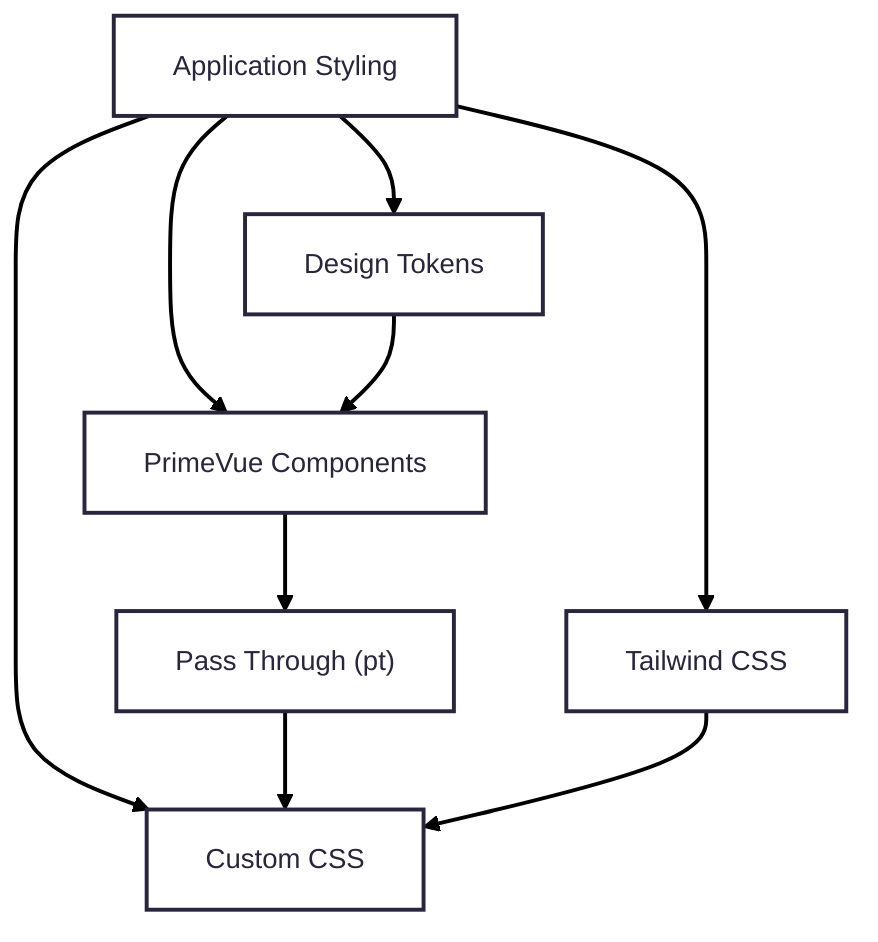

# Advantages
## 1. Centralized Theme Management
One of the most significant improvements in PrimeVue v5 is its Design Token based theming architecture. Instead of modifying component-specific CSS, developers can define global design values through Design Tokens. **Changes to colors, border radius, surface colors, or typography** automatically propagate to all related components, resulting in a consistent visual identity across the application.

**Observed Benefits**
- Single source of truth for application styling
- Consistent branding across all PrimeVue components
- Easier maintenance when updating the design system
- Reduced duplication of CSS
## 2. Mature Component Library
PrimeVue provides a comprehensive collection of production-ready components with well-designed default behaviors. Common UI interactions, animations, and accessibility features are already implemented, allowing developers to focus more on application logic rather than rebuilding common interface behaviors.

Examples include:
- Expand and collapse animations
- Ripple effects
- Dialog transitions
- Form validation support
- Built-in accessibility
- Responsive component behavior
This significantly reduces frontend development complexity compared to implementing these features manually.

## 3. Flexible Customization
Although PrimeVue provides polished default designs, it still offers extensive customization through several mechanisms:
- Design Tokens for global styling
- Pass Through (`pt`) for component-level customization
- Tailwind CSS utilities for layout and responsive design
- Custom CSS when necessary

The Pass Through documentation clearly exposes the available customization points for each component, making it easier to modify individual component instances without altering the component source.

## 4. Excellent Documentation
The official PrimeVue documentation is well organized and easy to navigate. The built-in search functionality allows developers to quickly locate components, APIs, and examples.

Strengths include:
- Comprehensive component documentation
- Interactive examples
- Complete API references
- Clearly documented Pass Through sections
- Detailed installation and configuration guides
The documentation greatly improves the developer experience, particularly when learning new components.

## 5. Tailwind CSS Compatibility
PrimeVue integrates well with Tailwind CSS, allowing both libraries to complement each other rather than compete.

A practical workflow is:
- **Design Tokens** manage the application's visual identity.
- **Tailwind CSS** handles layout, spacing, responsiveness, and utility styling.
- **Pass Through** customizes individual component internals when needed.
This separation of responsibilities results in cleaner and more maintainable code.‘
---
# Limitations
## 1. Initial Learning Curve
Although the Design Token architecture offers long-term benefits, understanding the hierarchy of Primitive, Semantic, and Component Tokens requires time.

Similarly, learning the Pass Through (`pt`) system can be challenging during the initial stages, as developers need to identify the correct PT section names before customizing component elements.

However, once these concepts are understood, customization becomes significantly more intuitive.

## 2. Overwhelming Theme Documentation
While the documentation itself is comprehensive, the theming section combines multiple concepts, including:
- Styled Mode
- Unstyled Mode
- Design Tokens
- Theme Presets
- CSS Variables
- CSS Layers
- Pass Through customization

Presenting these topics together can be overwhelming for developers who are new to the PrimeVue theming architecture. A more gradual introduction with conceptual explanations would improve the learning experience.

## 3. Licensing Changes
PrimeVue v5 introduces a license configuration during application setup. Even developers using the free Community edition are required to register for a license key.

Although the Community edition remains free, this additional setup step differs from earlier versions and may initially confuse new users.

## 4. SSR Compatibility Issues
When building the Proof of Concept, an issue was encountered when using Server Side Rendering (SSR).

PrimeVue injects component styles dynamically at runtime. Under certain SSR configurations, the injected styles may not be applied correctly after page refreshes, resulting in components appearing without their expected styling.

In the evaluation project, disabling SSR resolved the issue. While this appears to be related to the interaction between PrimeVue and the SSR environment rather than standard client-side rendering, it remains an important consideration for projects that rely on SSR.

---
# Final Recommendation
## Should our team adopt PrimeVue v5?
**Yes.** Based on this evaluation, PrimeVue v5 is recommended for future Vue 3 projects. Its Design Token architecture, mature component ecosystem, and official Tailwind CSS integration provide a maintainable and scalable solution for modern frontend development.

Compared to manually styling components, PrimeVue reduces development effort while maintaining flexibility for customization.

## Should we use Styled Mode or Unstyled Mode?
**Styled Mode.** Styled Mode already provides professionally designed components that meet the requirements of most business applications. Combined with Design Tokens, it allows global branding changes without extensive CSS customization.

Unstyled Mode is better suited for organizations building a completely custom design system. For most projects, it introduces unnecessary development effort without significant additional benefits.

## Should we rely on Design Tokens or Tailwind CSS for customization?
The recommended approach is to use both, with each serving a different purpose.

|Technology|Recommended Usage|
|---|---|
|Design Tokens|Global branding, colors, typography, border radius, surface colors, dark mode|
|Tailwind CSS|Layout, spacing, flexbox, grid, responsive design, sizing|
|Pass Through (`pt`)|Component-specific customization|
|Custom CSS|Only when Design Tokens or Pass Through cannot achieve the required result|
This layered approach keeps styling centralized while preserving flexibility for individual components.

## Recommended Architecture

This hierarchy ensures that:
- Visual identity remains centralized through Design Tokens.
- PrimeVue provides consistent and accessible component implementations.
- Tailwind CSS focuses on layout and responsiveness instead of replacing component styling.
- Component-specific adjustments are handled through Pass Through.
- Direct CSS overrides are minimized, improving maintainability and simplifying future upgrades.